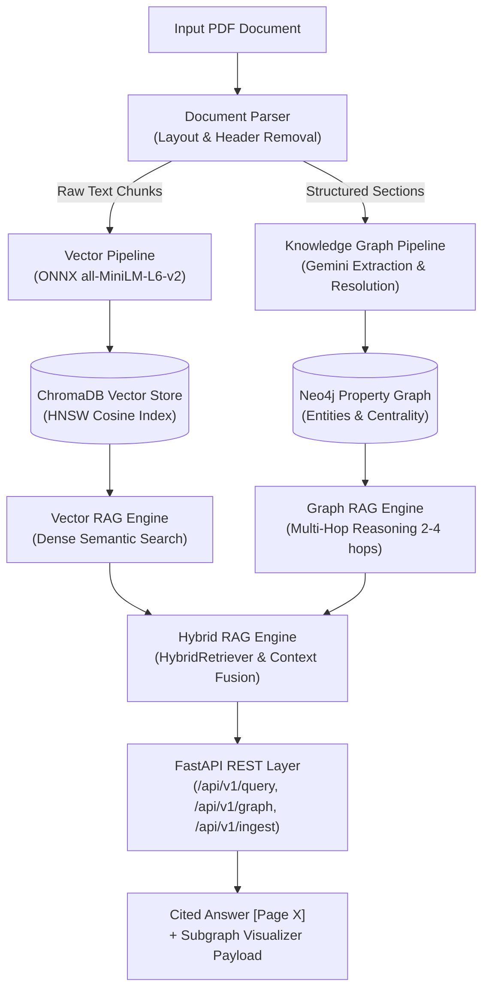

# Linkwise-Graph

**A hybrid GraphRAG and vector retrieval platform for document intelligence.**

Linkwise-Graph combines a Neo4j knowledge graph with ChromaDB dense vector search and Google Gemini synthesis to answer questions that span multiple entities, indirect relationships, and structural dependencies across documents. Every answer is grounded in source material and returned with bracketed page citations (`[Page X]`), an explicit reasoning chain, and the subgraph that supports it.

[](http://116.202.210.102:20324)
[](https://github.com/AmanBadola01/Linkwise-Graph)


---

## Overview

Conventional vector-only RAG retrieves text that is semantically similar to a query, but it cannot reliably trace how entities relate to one another across a document. Linkwise-Graph addresses this by indexing every document twice:

- **As a property graph in Neo4j** — entities, directed relationships, and degree centrality, enabling multi-hop relational reasoning.
- **As dense vectors in ChromaDB** — 384-dimensional embeddings from a locally hosted ONNX model, enabling fast semantic search at zero embedding cost.

At query time, a hybrid engine fuses both retrieval paths into a single context and synthesizes a cited answer. The platform ships as a full-stack application: a FastAPI backend, a Next.js frontend with an interactive force-directed graph visualizer, per-account authentication, and tenant-isolated data.

### Key capabilities

- **Automated graph construction** — Gemini-powered entity and relationship extraction with strict schema enforcement, followed by dynamic noise filtering and fuzzy entity resolution (RapidFuzz).
- **Multi-hop relational reasoning** — 2-to-4 hop Cypher traversals and shortest-path queries that produce auditable, step-by-step reasoning chains with page citations.
- **Tri-mode querying** — `vector`, `graph`, and `hybrid` modes behind a single endpoint, so callers can trade semantic recall against relational precision.
- **Interactive visualization** — a D3 force-directed graph explorer with entity-type filtering, focused subgraphs, and per-query subgraph highlighting.
- **Production-grade ingestion** — a six-stage pipeline with active-content (malware) screening, content-hash deduplication, parse-before-mutate ordering, and transactional rollback on failure.
- **Authenticated, tenant-isolated access** — bcrypt password hashing, short-lived JWT sessions in HttpOnly cookies, rate limiting, and per-account graph/vector isolation.

---

## Architecture

```text
                      ┌───────────────────────────────┐
                      │       Input PDF Document      │
                      └───────────────┬───────────────┘
                                      │
                                      ▼
                      ┌───────────────────────────────┐
                      │        Document Parser        │
                      │   (Layout & Header Removal)   │
                      └───────────────┬───────────────┘
                  ┌───────────────────┴───────────────────┐
                  │ (Text Chunks)       (Structured Nodes)│
                  ▼                                       ▼
  ┌───────────────────────────────┐       ┌───────────────────────────────┐
  │        Vector Pipeline        │       │   Knowledge Graph Pipeline    │
  ├───────────────────────────────┤       ├───────────────────────────────┤
  │ • EmbeddingService (ONNX)     │       │ • Entity Extractor (Gemini)   │
  │ • VectorStore (ChromaDB HNSW) │       │ • Dynamic Noise Filter        │
  │ • VectorRetriever             │       │ • Dynamic Entity Resolver     │
  │ • VectorSynthesizer           │       │ • GraphBuilder (Neo4j Ingest) │
  └───────────────┬───────────────┘       └───────────────┬───────────────┘
                  │                                       │
                  ▼                                       ▼
  ┌───────────────────────────────┐       ┌───────────────────────────────┐
  │       Vector RAG Engine       │       │     Neo4j Property Graph      │
  │    (Dense Semantic Search)    │       │ (Nodes, Edges, Meta, Degrees) │
  └───────────────┬───────────────┘       └───────────────┬───────────────┘
                  │                                       │
                  │                                       ▼
                  │                       ┌───────────────────────────────┐
                  │                       │       Graph RAG Engine        │
                  │                       │ • GraphRetriever (Subgraphs)  │
                  │                       │ • MultiHopReasoner (2-4 hops) │
                  │                       └───────────────┬───────────────┘
                  │                                       │
                  └───────────────────┬───────────────────┘
                                      │
                                      ▼
                      ┌───────────────────────────────┐
                      │       Hybrid RAG Engine       │
                      ├───────────────────────────────┤
                      │ • HybridRetriever (Fusion)    │
                      │ • HybridSynthesizer (Gemini)  │
                      └───────────────┬───────────────┘
                                      │
                                      ▼
                      ┌───────────────────────────────┐
                      │      FastAPI Backend API      │
                      │ • /api/v1/query  (Tri-Mode)   │
                      │ • /api/v1/graph  (Visualizer) │
                      │ • /api/v1/ingest (PDF Upload) │
                      │ • /api/v1/auth   (Accounts)   │
                      │ • /api/v1/health (Telemetry)  │
                      └───────────────┬───────────────┘
                                      │
                                      ▼
                      ┌───────────────────────────────┐
                      │   Next.js Frontend (App)      │
                      │  Upload · Ask · Graph · Auth  │
                      └───────────────────────────────┘
```

### Request flow



---

## Features

### Document ingestion

- Layout-aware PDF parsing with PyPDF, including running header/footer removal via multi-page line-frequency analysis and hierarchical section detection.
- Gemini structured extraction of entities, entity types, descriptions, directed relationships, and source page numbers.
- Dynamic noise filtering (temporal references, monetary amounts, generic labels, orphan nodes, self-loops) and entity resolution (person-initial expansion, RapidFuzz token-sort matching, alias rewiring).
- Active-content screening that rejects PDFs carrying JavaScript, embedded files, launch actions, or rich media before any parsing or indexing occurs.
- Content-hash deduplication per account, so re-uploading identical bytes returns the stored result without re-billing the LLM.
- Failure-safe semantics: parsing precedes any mutation, and a failed ingest rolls back its graph nodes and vector chunks, leaving no partial data queryable.

### Retrieval and synthesis

- **Vector mode** — local ONNX embeddings (`all-MiniLM-L6-v2`, 384 dimensions) with ChromaDB HNSW cosine search.
- **Graph mode** — fuzzy entity linking, 1–2 hop neighborhood expansion, central-hub fallback for broad queries, and variable-length (`2..4` hop) traversals with explicit reasoning chains.
- **Hybrid mode** — parallel graph and vector retrieval, fused into a dual-section context and synthesized with anti-hallucination prompting.

### Frontend

- Next.js 16 (App Router) with React 19, Tailwind CSS 4, Framer Motion, and D3 Force.
- Dedicated workspaces for document upload, question answering, graph exploration, and account management.
- Streaming API proxy (`/api/v1/[...path]`) that forwards session cookies and request bodies without buffering large uploads, with a configurable timeout for long ingests.

### Security

- JWT authentication (HS256, 12-hour default expiry) with per-user token versioning for server-side revocation.
- HttpOnly, SameSite=Lax session cookies; bearer tokens remain available for API clients.
- bcrypt password hashing with constant-time dummy verification to avoid account-enumeration timing leaks.
- Per-IP rate limiting on authentication endpoints, fail-closed CORS, and production hardening (interactive docs disabled when `ENVIRONMENT=production`).
- Tenant isolation via request-scoped account context across both Neo4j and ChromaDB.

---

## Technology stack

| Layer | Technology | Purpose |
|---|---|---|
| Frontend | Next.js 16, React 19, Tailwind CSS 4 | App Router UI, workspaces, and API proxy |
| Visualization | D3 Force, Framer Motion | Force-directed graph rendering and motion |
| Web framework | FastAPI 0.115+, Uvicorn | Asynchronous REST API and ASGI serving |
| Graph database | Neo4j 5 Community | Property graph, Cypher traversal, degree centrality |
| Vector database | ChromaDB | Persistent HNSW index with cosine similarity |
| Embeddings | ONNX `all-MiniLM-L6-v2` | 384-dimensional vectors computed locally on CPU |
| LLM | Google Gemini (`gemini-3.5-flash-lite`) | Structured extraction and cited answer synthesis |
| Entity resolution | RapidFuzz | Fuzzy matching and alias deduplication |
| Validation | Pydantic v2 | Typed domain models and API schemas |
| PDF processing | PyPDF | Layout-aware text and section extraction |
| Authentication | PyJWT, passlib (bcrypt) | Token issuance and password hashing |
| Process management | PM2 | Production process supervision and restart |

---

## Project structure

```text
Linkwise-Graph/
├── README.md
├── requirements.txt                 # Backend Python dependencies
├── ecosystem.config.js              # PM2 production configuration
├── .env.example                     # Environment configuration template
│
├── backend/
│   ├── app/
│   │   ├── main.py                  # FastAPI entry point, CORS, lifespan
│   │   ├── api/
│   │   │   ├── deps.py              # Auth dependencies and session handling
│   │   │   └── v1/
│   │   │       ├── auth.py          # Signup, login, logout, password change
│   │   │       ├── health.py        # GET /api/v1/health
│   │   │       ├── graph.py         # GET /api/v1/graph
│   │   │       ├── query.py         # POST /api/v1/query (tri-mode)
│   │   │       └── ingest.py        # POST /api/v1/ingest (6-stage pipeline)
│   │   ├── core/
│   │   │   └── tenant.py            # Per-request account context
│   │   ├── models/                  # Document, graph, vector, hybrid models
│   │   ├── schemas/
│   │   │   └── api_schemas.py       # Request/response contracts
│   │   └── services/
│   │       ├── auth/                # Security, user store, rate limiting
│   │       ├── graph/               # Parser, extractor, filters, builder,
│   │       │                        # retriever, multi-hop reasoner
│   │       ├── vector/              # Embeddings, store, retriever, synthesizer
│   │       ├── hybrid/              # Fusion retriever and synthesizer
│   │       ├── ingest_registry.py   # Content-hash deduplication registry
│   │       └── llm_errors.py        # LLM failure classification
│   └── tests/                       # Regression and security test suites
│
└── frontend/
    ├── package.json
    ├── next.config.ts
    └── src/
        ├── app/                     # Routes: home, upload, ask, graph,
        │                            # login, signup, account, about
        ├── components/              # Upload, ask, graph, auth, layout UI
        ├── lib/                     # API client, sessions, graph layout
        └── middleware.ts            # Session-aware route protection
```

---

## Getting started

### Prerequisites

- Python 3.10 or later
- Node.js 20 or later and npm
- Docker (for Neo4j), or an existing Neo4j 5 instance
- A Google Gemini API key ([Google AI Studio](https://aistudio.google.com/app/apikey))

### 1. Clone the repository

```bash
git clone https://github.com/AmanBadola01/Linkwise-Graph.git
cd Linkwise-Graph
```

### 2. Configure the environment

```bash
cp .env.example .env
```

Edit `.env` and set at minimum:

```env
GEMINI_API_KEY=your_gemini_api_key_here
NEO4J_URI=bolt://localhost:7687
NEO4J_USER=neo4j
NEO4J_PASSWORD=your_password
JWT_SECRET=replace-with-a-long-random-secret   # 32+ characters, required
```

> The server refuses to start without a valid `JWT_SECRET`. Generate one with `openssl rand -hex 32` and never commit a real value.

See [.env.example](.env.example) for the full set of options, including `CORS_ORIGINS`, `COOKIE_SECURE`, `MAX_UPLOAD_MB`, and `ENVIRONMENT`.

### 3. Start Neo4j

```bash
docker run -d \
  --name graphrag-neo4j \
  -p 7474:7474 -p 7687:7687 \
  -e NEO4J_AUTH=neo4j/your_password \
  neo4j:5-community
```

### 4. Run the backend

```bash
python -m venv .venv
source .venv/bin/activate        # Windows: .venv\Scripts\Activate.ps1
pip install -r requirements.txt
uvicorn backend.app.main:app --reload --host 0.0.0.0 --port 8000
```

Interactive API documentation is available at `http://localhost:8000/docs` (disabled in production).

### 5. Run the frontend

```bash
cd frontend
npm install
# Point the frontend at the backend (defaults to http://127.0.0.1:8003):
#   LINKWISE_BACKEND_URL=http://127.0.0.1:8000
npm run dev
```

Open `http://localhost:3000`, create an account, upload a PDF, and start asking questions.

---

## API reference

All endpoints are versioned under `/api/v1`. Except for health checks and authentication, every endpoint requires a valid session (HttpOnly cookie or `Authorization: Bearer <token>`).

| Method | Endpoint | Auth | Description |
|---|---|---|---|
| `GET` | `/` | No | Service metadata and endpoint index |
| `GET` | `/api/v1/health` | No | Live probes for Neo4j, ChromaDB, and Gemini |
| `POST` | `/api/v1/auth/signup` | No | Create an account and start a session |
| `POST` | `/api/v1/auth/login` | No | Sign in and start a session |
| `POST` | `/api/v1/auth/logout` | Yes | End the current session |
| `GET` | `/api/v1/auth/me` | Yes | Return the authenticated user |
| `POST` | `/api/v1/auth/change-password` | Yes | Change password and revoke prior tokens |
| `GET` | `/api/v1/graph` | Yes | Full graph or focused subgraph (`?entity=&depth=1..5`) |
| `POST` | `/api/v1/query` | Yes | Tri-mode RAG query (`vector` \| `graph` \| `hybrid`) |
| `POST` | `/api/v1/ingest` | Yes | PDF upload and six-stage ingestion (multipart) |

### Query example

```bash
curl -X POST http://localhost:8000/api/v1/query \
  -H "Content-Type: application/json" \
  -H "Authorization: Bearer <token>" \
  -d '{
    "query": "What subsystem does the Lead Architect oversee, and what are its performance limits?",
    "mode": "hybrid",
    "top_k": 3,
    "max_hops": 3
  }'
```

Responses include the cited answer, the step-by-step reasoning chain, the active subgraph (nodes and edges) for visualization, matched text chunks, deduplicated source pages, and the parameters actually applied per mode (`effective_top_k` / `effective_max_hops`).

### Programmatic usage

```python
from backend.app.services.graph import (
    DocumentParser, EntityExtractor, NoiseFilter, EntityResolver, GraphBuilder,
)
from backend.app.services.hybrid import HybridRetriever, HybridSynthesizer

parser = DocumentParser()
parsed_doc = parser.parse_pdf("path/to/document.pdf")

extractor = EntityExtractor()
raw = [extractor.extract_from_section(s) for s in parsed_doc.sections]

clean = [NoiseFilter().filter(ext) for ext in raw]
nodes, edges = EntityResolver().resolve(clean)

builder = GraphBuilder()
builder.setup_schema()
builder.ingest_nodes(nodes)
builder.ingest_edges(edges)
builder.compute_degrees()

retriever = HybridRetriever()
synthesizer = HybridSynthesizer()
fused = retriever.retrieve(
    query="What subsystem does the Lead Architect oversee?",
    top_k_vector=3, max_hops_graph=3,
)
result = synthesizer.synthesize(fused)
print(result.answer)        # cited answer with [Page X] markers
print(result.source_pages)  # deduplicated source pages
```

---

## Deployment

The repository includes a PM2 configuration ([ecosystem.config.js](ecosystem.config.js)) that runs both tiers under process supervision with automatic restart:

| Service | Port | Description |
|---|---|---|
| `linkwise-frontend` | `20324` | Next.js production server (public) |
| `linkwise-backend` | `20325` | FastAPI/Uvicorn API (bound to `0.0.0.0`) |

```bash
npm install -g pm2
pm2 start ecosystem.config.js
pm2 save
```

**Live deployment:** [http://116.202.210.102:20324](http://116.202.210.102:20324)

For production, set `ENVIRONMENT=production` (disables `/docs`, `/redoc`, and `/openapi.json`), `COOKIE_SECURE=true` behind HTTPS, and a restrictive `CORS_ORIGINS` allowlist.

---

## Testing

Backend regression and security suites live in `backend/tests/` and run with pytest:

```bash
pip install -r requirements.txt
pytest backend/tests -q
```

The suites cover query validation, ingestion safety (active-content rejection, rollback, deduplication), authentication hardening, and tenant isolation.

---

## License

This project is licensed under the MIT License.
