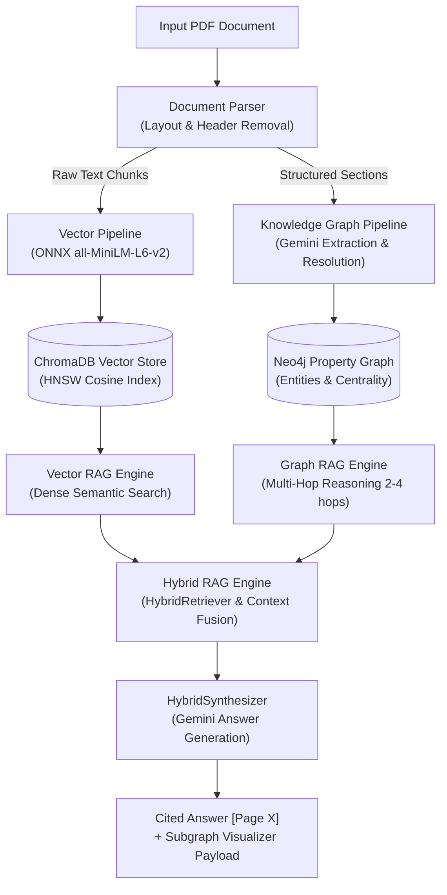

# Linkwise-Graph 

> **A Hybrid GraphRAG & Vector Retrieval-Augmented Generation Platform** combining Knowledge Graph traversal (Neo4j) with dense semantic search (ChromaDB) and Google Gemini for deep relational reasoning and factual document intelligence.

---

## 📖 Overview

Standard Vector RAG struggles with complex questions that span multiple entities, indirect relationships, or structural dependencies across documents. **Linkwise-Graph** solves this by parsing documents into both a **property graph in Neo4j** and a **persistent vector database in ChromaDB**, then fusing their outputs into a unified context for factual, cited answer synthesis.

It enables:
- **Entity & Relationship Extraction:** Automated extraction of entities, directed relationships, and metadata using Google Gemini with strict schema enforcement.
- **Dynamic Noise Filtering & Entity Resolution:** Normalizes variations (e.g., `D. Kim` → `Daniel Kim`), deduplicates aliases, and filters generic stopwords without hardcoded rules.
- **Multi-Hop Relational Reasoning:** Traverses 2-to-4 hop paths across the knowledge graph to trace explicit reasoning chains with source page citations.
- **Modular Vector Retrieval:** Local, zero-cost ONNX embedding generation (`all-MiniLM-L6-v2`) paired with ChromaDB HNSW cosine similarity search.
- **Hybrid Fusion & Synthesis:** Combines graph relational backbones with detailed text paragraphs to answer complex questions with bracketed page citations (`[Page X]`).

---

## 🏗️ Architecture

```text
                      ┌───────────────────────────────┐
                      │      Input PDF Document       │
                      └───────────────┬───────────────┘
                                      │
                                      ▼
                      ┌───────────────────────────────┐
                      │        Document Parser        │
                      │   (Layout & Header Removal)   │
                      └───────────────┬───────────────┘
                                      │
                  ┌───────────────────┴───────────────────┐
                  │ (Text Chunks)       (Structured Nodes)│
                  ▼                                       ▼
  ┌───────────────────────────────┐       ┌───────────────────────────────┐
  │        Vector Pipeline        │       │   Knowledge Graph Pipeline    │
  ├───────────────────────────────┤       ├───────────────────────────────┤
  │ • EmbeddingService (ONNX)     │       │ • Entity Extractor (Gemini)   │
  │ • VectorStore (ChromaDB HNSW) │       │ • Dynamic Noise Filter        │
  │ • VectorRetriever             │       │ • Dynamic Entity Resolver     │
  │ • VectorSynthesizer           │       │ • GraphBuilder (Neo4j Ingest) │
  └───────────────┬───────────────┘       └───────────────┬───────────────┘
                  │                                       │
                  ▼                                       ▼
  ┌───────────────────────────────┐       ┌───────────────────────────────┐
  │       Vector RAG Engine       │       │     Neo4j Property Graph      │
  │    (Dense Semantic Search)    │       │ (Nodes, Edges, Meta, Degrees) │
  └───────────────┬───────────────┘       └───────────────┬───────────────┘
                  │                                       │
                  │                                       ▼
                  │                       ┌───────────────────────────────┐
                  │                       │       Graph RAG Engine        │
                  │                       │ • GraphRetriever (Subgraphs)  │
                  │                       │ • MultiHopReasoner (2-4 hops) │
                  │                       └───────────────┬───────────────┘
                  │                                       │
                  └───────────────────┬───────────────────┘
                                      │
                                      ▼
                      ┌───────────────────────────────┐
                      │       Hybrid RAG Engine       │
                      ├───────────────────────────────┤
                      │ • HybridRetriever (Fusion)    │
                      │ • HybridSynthesizer (Gemini)  │
                      └───────────────┬───────────────┘
                                      │
                                      ▼
                      ┌───────────────────────────────┐
                      │  Cited Answer [Page X] Output │
                      │  + Visualizer Subgraph Payload│
                      └───────────────────────────────┘
```

### System Dataflow



---

## 📁 Project Structure

```text
Linkwise-Graph/
├── .env.example                               # Environment template
├── .gitignore                                 # Git ignore (venv, env, chroma, datasets)
├── requirements.txt                           # Production Python dependencies
├── README.md                                  # Project documentation
│
└── backend/
    └── app/
        ├── models/
        │   ├── __init__.py                    # Model exports
        │   ├── document.py                    # DocumentSection, ParsedDocument models
        │   ├── graph.py                       # Entity, Relationship, GraphNode, GraphEdge models
        │   ├── vector.py                      # MatchedChunk, VectorRetrievalResult models
        │   └── hybrid.py                      # FusedContext, HybridRetrievalResult models
        │
        └── services/
            ├── __init__.py                    # Top-level service delegation exports
            │
            ├── graph/                         # Knowledge Graph Pipeline & Graph RAG
            │   ├── __init__.py                # Graph module exports
            │   ├── document_parser.py         # PDF layout-aware chunking & heading extraction
            │   ├── entity_extractor.py        # Gemini structured extraction with backoff
            │   ├── noise_filter.py            # Regex & semantic noise pruning
            │   ├── entity_resolver.py         # RapidFuzz deduplication & alias rewiring
            │   ├── graph_builder.py           # Neo4j schema, constraints, degree centrality
            │   ├── graph_retriever.py         # Entity linking, subgraphs, central hub fallback
            │   └── multihop_reasoner.py       # 2-4 hop Cypher path traversal & reasoning chains
            │
            ├── vector/                        # Modular Vector RAG
            │   ├── __init__.py                # Vector module exports
            │   ├── embedding_service.py       # ONNX all-MiniLM-L6-v2 local CPU embedder
            │   ├── vector_store.py            # ChromaDB persistent collection & HNSW index
            │   ├── vector_retriever.py        # Semantic query search & MatchedChunk ranking
            │   └── vector_synthesizer.py      # Context linearization & Gemini answer synthesis
            │
            └── hybrid/                        # Hybrid RAG Engine
                ├── __init__.py                # Hybrid module exports
                ├── hybrid_retriever.py        # Dual retrieval coordinator & context fusion
                └── hybrid_synthesizer.py      # Dual-grounded cited answer synthesis
```

---

## 🛠️ Features Implemented

### 1. Document Ingestion & Parsing (`backend/app/services/graph/document_parser.py`)
- Extracts text from multi-page PDFs with visual layout awareness.
- Computes dynamic multi-page line frequency analysis to eliminate running headers and footers.
- Detects hierarchical sections via regex pattern analysis (numbered, markdown, all-caps, title-case).

### 2. Knowledge Graph Pipeline (`backend/app/services/graph/`)
- **Entity Extraction (`entity_extractor.py`):** Uses Google Gemini structured output to extract nodes, node types, descriptions, directed relationships, and source page numbers.
- **Dynamic Noise Filtering (`noise_filter.py`):** Filters out temporal references, monetary amounts, generic lowercase labels, orphan nodes, and self-loops.
- **Entity Resolution (`entity_resolver.py`):**
  - Resolves person initial aliases (e.g. `D. Kim` → `Daniel Kim`).
  - Matches token-sort fuzzy similarity using RapidFuzz.
  - Rewires duplicate relationships to canonical nodes.
- **Graph Builder (`graph_builder.py`):**
  - Enforces unique constraints and full-text indexes in Neo4j.
  - Ingests canonical nodes and directed relationships.
  - Computes degree centrality dynamically on graph ingestion.

### 3. Graph Retrieval & Multi-Hop Reasoning (`backend/app/services/graph/`)
- **Graph Retriever (`graph_retriever.py`):**
  - Links queried entities via fuzzy matching and full-text indexes.
  - Expands 1-to-2 hop subgraphs around focal entities.
  - **Central Hub Fallback:** Handles broad global queries by retrieving highest degree centrality nodes.
- **Multi-Hop Reasoner (`multihop_reasoner.py`):**
  - Executes variable-length Cypher traversals (`2..4` hops) and shortest-path queries.
  - Generates explicit step-by-step reasoning chains with page citations:
    $$\text{Entity A} \xrightarrow{\text{RELATION [Page X]}} \text{Entity B} \xrightarrow{\text{RELATION [Page Y]}} \text{Entity C}$$
  - Synthesizes grounded natural language answers using Gemini.

### 4. Modular Vector RAG (`backend/app/services/vector/`)
- **`embedding_service.py`:** Generates 384-dimensional dense embeddings locally on CPU using the ONNX-optimized `all-MiniLM-L6-v2` model ($0 API cost).
- **`vector_store.py`:** Wraps ChromaDB persistent storage at `./chroma_data` using HNSW indexing with cosine distance metric.
- **`vector_retriever.py`:** Embeds queries, retrieves nearest neighbors, normalizes distance into similarity scores $[0, 1]$, and produces typed `MatchedChunk` objects.
- **`vector_synthesizer.py`:** Formats retrieved chunks into linearized context blocks and prompts Gemini (`gemini-3.5-flash-lite`) to produce accurate answers with bracketed page citations (`[Page X]`).

### 5. Hybrid RAG Engine (`backend/app/services/hybrid/`)
- **`hybrid_retriever.py`:** Executes parallel retrieval across both Neo4j (graph paths/subgraphs) and ChromaDB (vector chunks), deduplicates referenced source pages, and constructs a structured dual-section `FusedContext`.
- **`hybrid_synthesizer.py`:** Feeds the fused context to Gemini with anti-hallucination prompting, producing a complete `HybridRetrievalResult` containing:
  - Factual natural language answer with `[Page X]` citations.
  - Active subgraph nodes and directed edges for interactive frontend visualization.
  - Deduplicated source pages and supporting text chunks.

---

## 🚀 Getting Started

### Prerequisites
- Python 3.10+ (Tested on Python 3.14)
- Docker Desktop (for running Neo4j)
- Google Gemini API Key

### 1. Clone & Set Up Environment

```bash
git clone https://github.com/AmanBadola01/Linkwise-Graph.git
cd Linkwise-Graph

# Create and activate virtual environment
python -m venv .venv
# Windows (PowerShell):
.venv\Scripts\Activate.ps1
# Linux/macOS:
source .venv/bin/activate

# Install dependencies
pip install -r requirements.txt
```

### 2. Configure Environment Variables

Create a `.env` file in the project root:

```env
# Google Gemini API
GEMINI_API_KEY=your_gemini_api_key_here

# Neo4j Graph Database
NEO4J_URI=bolt://localhost:7687
NEO4J_USER=neo4j
NEO4J_PASSWORD=your_password

# Vector Database
CHROMA_PERSIST_DIR=./chroma_data
```

### 3. Start Neo4j Container

```bash
docker run -d \
  --name graphrag-neo4j \
  -p 7474:7474 -p 7687:7687 \
  -e NEO4J_AUTH=neo4j/your_password \
  neo4j:5-community
```

---

## ⚡ Usage Examples

### 1. Knowledge Graph Ingestion Pipeline Programmatically

```python
from backend.app.services.graph import (
    DocumentParser,
    EntityExtractor,
    NoiseFilter,
    EntityResolver,
    GraphBuilder
)

# 1. Parse Document Layout
parser = DocumentParser()
parsed_doc = parser.parse_pdf("path/to/document.pdf")

# 2. Extract Entities & Relationships
extractor = EntityExtractor()
raw_extractions = [extractor.extract_section(s) for s in parsed_doc.sections]

# 3. Filter Noise
filter_service = NoiseFilter()
clean_extractions = [filter_service.filter(ext) for ext in raw_extractions]

# 4. Resolve Aliases & Deduplicate
resolver = EntityResolver()
resolved_nodes, resolved_edges = resolver.resolve(clean_extractions)

# 5. Build Graph in Neo4j
builder = GraphBuilder()
builder.setup_schema()
builder.ingest_nodes(resolved_nodes)
builder.ingest_edges(resolved_edges)
builder.compute_degrees()
```

### 2. Querying via Vector RAG Programmatically

```python
from backend.app.services.vector import (
    EmbeddingService,
    VectorStore,
    VectorRetriever,
    VectorSynthesizer
)

# Initialize components
embedder = EmbeddingService()
store = VectorStore()
retriever = VectorRetriever(embedding_service=embedder, vector_store=store)
synthesizer = VectorSynthesizer()

# Retrieve & Synthesize
query = "What is the architecture of the payment service?"
chunks = retriever.retrieve_chunks(query=query, top_k=3)
result = synthesizer.synthesize(query=query, matched_chunks=chunks)

print("Answer:", result.answer)
for chunk in result.matched_chunks:
    print(f"- [Page {chunk.page_number}] {chunk.section_title} (Score: {chunk.score})")
```

### 3. Multi-Hop Graph Reasoning Programmatically

```python
from backend.app.services.graph import MultiHopReasoner

reasoner = MultiHopReasoner()
result = reasoner.reason_and_answer(query="How does Daniel Kim relate to the PayCore architecture?")

print("Answer:", result.answer)
print("Reasoning Chain:")
for step in result.reasoning_chain:
    print(" ", step)
```

### 4. Querying via Hybrid RAG Programmatically

```python
from backend.app.services.hybrid import HybridRetriever, HybridSynthesizer

# Initialize hybrid components
retriever = HybridRetriever()
synthesizer = HybridSynthesizer()

# Execute dual retrieval & context fusion
query = "What system does Sarah Jenkins govern and what are its performance thresholds?"
fused_context = retriever.retrieve(query=query, top_k_vector=3, max_hops_graph=3)

# Synthesize cited answer
result = synthesizer.synthesize(fused_context)

print("Answer:", result.answer)
print("Source Pages:", result.source_pages)
print(f"Visualizer Nodes: {len(result.subgraph_nodes)}, Edges: {len(result.subgraph_edges)}")
```

---

## 📋 Technology Stack

| Layer | Component | Description |
|---|---|---|
| **Graph Database** | Neo4j 5 Community | Property graph, Cypher queries, shortest paths, degree centrality |
| **Vector Database** | ChromaDB | Persistent local HNSW vector index with cosine metric |
| **Embeddings** | ONNX `all-MiniLM-L6-v2` | 384-dimensional dense vectors on CPU (zero cost) |
| **LLM & Reasoning** | Google Gemini `gemini-3.5-flash-lite` | Entity extraction & cited answer synthesis |
| **Entity Resolution** | RapidFuzz | Fuzzy token matching and person initial deduplication |
| **Data Validation** | Pydantic v2 | Strictly typed domain models for document, graph, vector, & hybrid |
| **PDF Extraction** | PyPDF | Layout-aware paragraph and section parser |

---

## 📄 License

This project is licensed under the MIT License.
